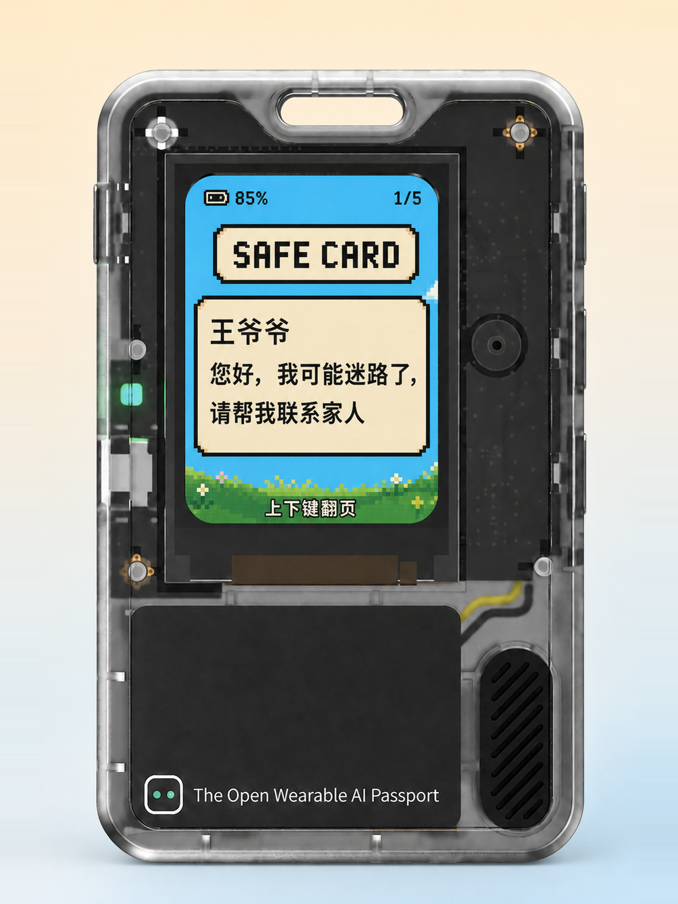
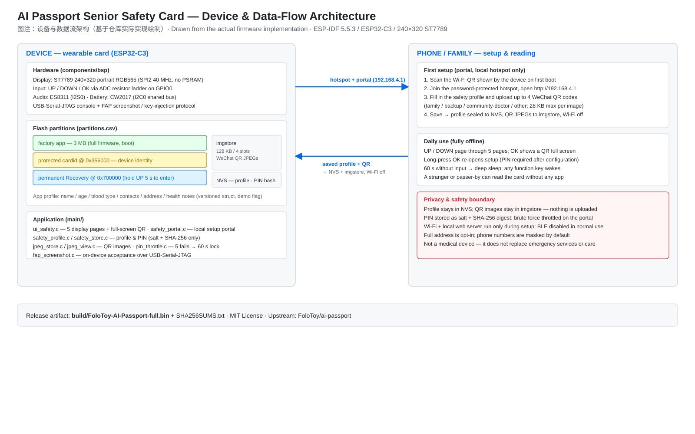
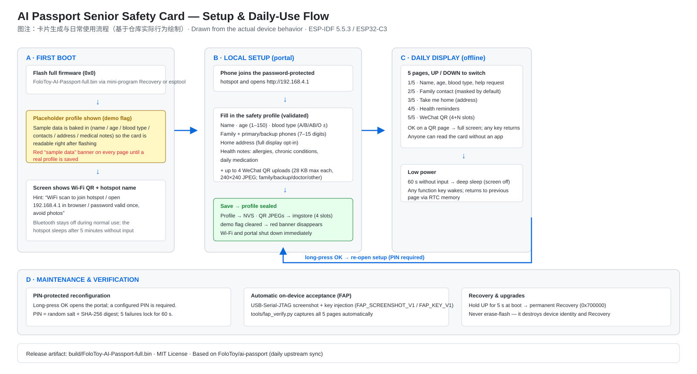

<p align="right">
  [中文](#中文) | [English](#english) · 配对文件 <a href="README.md">README.md</a>
</p>

# AI Passport · Senior Safety Card (Health-Info-Card)

**AI Passport Senior Safety Card（健康信息卡）**把 FoloToy AI Passport 变成一张**离线、可穿戴的求助卡**：老人迷路或需要帮助时，旁人不需要任何 App，就能从屏幕读到称呼、求助说明、家庭联系人、居住区域、健康提醒和微信二维码。

这是一个 **ESP-IDF 5.5.3 / ESP32-C3 嵌入式固件项目**：没有桌面 UI 可运行，交付物是烧录到设备的固件（Release 为 `.bin`）。

[](https://github.com/ReSerendipity/Health-Info-Card/actions/workflows/ci.yml)
[](https://github.com/ReSerendipity/Health-Info-Card/releases)
[](LICENSE)
[](https://github.com/ReSerendipity/Health-Info-Card/commits/main)
[](https://github.com/ReSerendipity/Health-Info-Card)
[](.github/CONTRIBUTING.md)

---

## 中文

### 项目简介

Senior Safety Card（健康信息卡）是基于 FoloToy AI Passport（ESP32-C3 / 240×320 ST7789）的离线求助应用。设备以卡片形态随身佩戴，屏幕展示 **5 页安心资料**：

| 页 | 内容 |
| --- | --- |
| 1/5 | 姓名、年龄、血型、求助说明 |
| 2/5 | 家属联系人与电话（默认脱敏显示） |
| 3/5 | 带我回家：家庭住址（可选完整展示） |
| 4/5 | 健康提醒：过敏史、慢病、日常用药 |
| 5/5 | 微信二维码（最多 4 张：家属／备用／社区医生／其他） |

全部资料保存在设备本地（NVS 与 `imgstore` 分区），不依赖互联网服务。项目保留原版 AI Passport 的**小程序 BLE 安装契约**（受保护的 `cardid` 与永久 Recovery 分区），升级可沿用原有资料与二维码。

### 核心特性

- **完全离线**：资料只在设备 NVS、二维码只在 `imgstore`，从不上传；Wi-Fi 与本地设置页仅在设置期间运行，正常使用时关闭蓝牙。
- **5 页一键可读**：上／下键翻页；二维码页短按确认键全屏显示，按任意键返回；旁人无需任何 App 即可阅读。
- **低功耗**：展示页 60 秒无操作进入深度休眠，任意功能键唤醒；设置热点 5 分钟无操作休眠。
- **PIN 保护的重置**：长按确认键重新打开本地设置；管理密码只保存随机盐 + SHA-256 摘要，输入节流（5 次失败锁定 60 秒）抵御在线暴力破解。
- **隐私默认**：电话默认脱敏、完整住址可选展示；内置示例资料带红色"示例数据"横幅，保存真实资料后自动消失。
- **可自动验收**：USB-Serial-JTAG 截图 + 按键注入协议（FAP_SCREENSHOT_V1 / FAP_KEY_V1），`tools/fap_verify.py` 可自动完成 5 页真机验收。

### 展示

设备屏幕上的安心卡主界面（内置示例资料，带红色"示例数据"横幅）：



设备正面（可穿戴卡片形态）：


设备多角度视图：


设备与数据流架构（硬件、Flash 分区、本地设置 portal、隐私边界）：



卡片生成与日常使用流程（首次开机 → 本地设置 → 离线展示 → 维护与验收）：



### 快速开始

**环境**：ESP-IDF 5.5.3（`IDF_PATH` 请使用正斜杠，官方 `recovery_boot_hook` 的 CMake 在反斜杠路径下会解析失败）、Python 3（含 `esptool`）。

**安装与构建**（仓库根目录）：

```bash
git clone https://github.com/ReSerendipity/Health-Info-Card.git
cd Health-Info-Card
source /path/to/esp-idf/export.sh        # ESP-IDF 5.5.3
idf.py build                             # 编译固件
```

**启动（烧录）**：发布与安装只使用合并后的完整镜像：

```bash
cd build
python -m esptool --chip esp32c3 merge_bin -o FoloToy-AI-Passport-full.bin "@..\build\flash_args"
python -m esptool --chip esp32c3 -p COM3 -b 460800 write_flash 0x0 FoloToy-AI-Passport-full.bin
```

已写入设备身份（provisioned）的机器，优先通过 AI Passport 小程序 Recovery 流程安装；**不要执行 `erase-flash`**，它会清除设备身份和永久 Recovery。

**最小验证**：仓库自带主机侧校验（无需真机）：

```bash
./tools/validate.sh --static
```

构建通过不等于真机验证。正式发布前，应在实体设备上按 [`docs/health-info-card-guide.md`](docs/health-info-card-guide.md) 检查首次设置、全部资料页、二维码扫码、管理密码、一分钟休眠、按键唤醒与 Recovery 入口，或用 `tools/fap_verify.py COM3 <out_dir>` 自动采集 5 页截图。

### 系统要求与兼容性

- ESP32-C3、8 MB Flash、3 MB 主应用分区（`partitions.csv`）。
- `cardid` 固定于 `0x356000`（受保护，设备身份）；永久 Recovery 固定于 `0x700000`；开机持续按住上键 5 秒进入 Recovery。
- NVS 命名空间、键名与 `imgstore`／`imgframe` 地址与原版一致：只要分区内容保留，升级后可沿用原有资料与二维码。
- 二维码图片单张上限 28 KB（`imgstore` 4 槽，合计约 112 KB）；前端将手机图片缩为 240×240 JPEG。
- 上游基线为 [`FoloToy/ai-passport`](https://github.com/FoloToy/ai-passport)，仓库通过 `sync-main.yml` 每日自动同步。

### 使用示例

日常使用（离线）：

1. 上／下键在 5 页间切换；二维码页短按确认键全屏显示，按任意键返回。
2. 长按确认键重新打开本地设置：扫描屏幕 Wi-Fi 二维码 → 连接热点 → 浏览器打开 `http://192.168.4.1` → 验证管理密码后修改资料。
3. 展示页 60 秒无操作进入深度休眠，任意功能键唤醒并回到休眠前页面（RTC 内存）。

真机自动验收（USB-Serial-JTAG）：

```bash
python tools/fap_verify.py COM3 _fap_shots    # 自动采集并翻页全部 5 页
```

### FAQ

1. **这是医疗器械吗？** 不是。它只是一张实体信息卡，不提供医疗建议，也不替代急救服务或专业照护。
2. **数据会被上传吗？** 不会。资料只存设备 NVS、二维码只存 `imgstore`；Wi-Fi 仅在设置期间运行，正常使用关闭蓝牙。
3. **如何重新设置资料？** 长按确认键打开本地设置；若已设置管理密码，设置页会要求验证（5 次失败锁定 60 秒）。
4. **为什么屏幕上一直有红色"示例数据"横幅？** 内置占位资料带有 `demo` 标记；从设置页保存真实资料后，横幅自动消失。
5. **如何升级固件？** 优先使用小程序 Recovery 流程安装新版本；分区内容保留时，资料与二维码可继续沿用。不要 `erase-flash`。

### 文档与治理

- 文档索引：[`docs/INDEX.md`](docs/INDEX.md)；权威变更记录：[`docs/CHANGELOG.md`](docs/CHANGELOG.md)。
- 交付指南（字段、占位数据替换、真机验收结果）：[`docs/health-info-card-guide.md`](docs/health-info-card-guide.md)。
- CI：`ci.yml`（PR 静态检查 + ESP-IDF 5.5.3 固件构建）· `build-firmware.yml`（tag 构建并发布 `.bin` + `SHA256SUMS.txt`）· `deploy-pages.yml`（docs → GitHub Pages）· `sync-main.yml`（每日同步上游）。
- AI 协作入口：`local/AGENTS.md`（本地文件，不入库）；开发流程见 [`docs/development/agent-guide.md`](docs/development/agent-guide.md)。

### 贡献 / 安全 / 支持

- 贡献指南：[`.github/CONTRIBUTING.md`](.github/CONTRIBUTING.md) · 行为准则：[`.github/CODE_OF_CONDUCT.md`](.github/CODE_OF_CONDUCT.md)
- 安全报告：[`.github/SECURITY.md`](.github/SECURITY.md) · 支持渠道：[`.github/SUPPORT.md`](.github/SUPPORT.md)

### 许可证

基于 [MIT License](LICENSE) 发布。版权所有 (c) 2026 FoloToy。

---

## English

### Introduction

**AI Passport Senior Safety Card (Health-Info-Card)** turns the FoloToy AI Passport into an **offline, wearable help card**: when an older adult gets lost or needs help, a passer-by can read the wearer's name, help message, family contacts, approximate home area, health notes and WeChat QR codes directly from the screen — no app required.

This is an **ESP-IDF 5.5.3 / ESP32-C3 embedded firmware project**: there is no desktop UI to run; the deliverable is firmware flashed to the device (releases ship a `.bin`).

### Core features

- **Fully offline**: the profile lives in the device NVS partition and QR images in the `imgstore` partition — nothing is uploaded. Wi-Fi and the local setup page run only during setup; Bluetooth is disabled during normal use.
- **Five readable pages**: UP/DOWN switch pages; OK shows a QR code full screen (any key returns). Anyone can read the card without an app.
- **Low power**: the display deep-sleeps after 60 s without input; any function key wakes it. The setup hotspot sleeps after five minutes without input.
- **PIN-protected reconfiguration**: long-press OK to reopen local setup; the PIN is stored only as a random salt plus SHA-256 digest, and attempts are throttled (5 failures lock for 60 s) against brute force.
- **Privacy by default**: phone numbers are masked by default and full address display is opt-in; the built-in placeholder profile shows a red "sample data" banner until a real profile is saved.
- **Automated acceptance**: an embedded screenshot/key-injection protocol over USB-Serial-JTAG (FAP_SCREENSHOT_V1 / FAP_KEY_V1) lets `tools/fap_verify.py` capture all five pages on real hardware.

### Screenshots

The safety-card main screen (built-in sample profile with the red "sample data" banner):


Device front (wearable card form factor):


Device multi-angle views:


Device and data-flow architecture (hardware, Flash partitions, local setup portal, privacy boundary):


Setup and daily-use flow (first boot → local setup → offline display → maintenance and verification):


### Quick start

**Environment**: ESP-IDF 5.5.3 (`IDF_PATH` must use forward slashes — the official `recovery_boot_hook` CMake breaks on backslash paths), Python 3 (with `esptool`).

**Build** (repository root):

```bash
git clone https://github.com/ReSerendipity/Health-Info-Card.git
cd Health-Info-Card
source /path/to/esp-idf/export.sh        # ESP-IDF 5.5.3
idf.py build
```

**Flash**: publish and install only the merged full image:

```bash
cd build
python -m esptool --chip esp32c3 merge_bin -o FoloToy-AI-Passport-full.bin "@..\build\flash_args"
python -m esptool --chip esp32c3 -p COM3 -b 460800 write_flash 0x0 FoloToy-AI-Passport-full.bin
```

On a provisioned device, prefer the AI Passport mini-program Recovery flow. Never use `erase-flash`; it destroys per-device identity and the permanent Recovery.

**Minimal validation** (host-side, no hardware required):

```bash
./tools/validate.sh --static
```

Build success is not device validation. Before treating a release as hardware-verified, walk the first-setup flow, all pages, QR scanning, PIN protection, one-minute sleep, key wake and Recovery entry on physical hardware per [`docs/health-info-card-guide.md`](docs/health-info-card-guide.md), or run `tools/fap_verify.py COM3 <out_dir>` to capture all five pages automatically.

### System requirements and compatibility

- ESP32-C3 with 8 MB Flash and a 3 MB application partition (`partitions.csv`).
- Protected `cardid` at `0x356000` (device identity); permanent Recovery at `0x700000`; hold UP for five seconds at boot to enter Recovery.
- NVS namespace/keys and `imgstore`/`imgframe` addresses match the original release, so an existing profile and QR images can be reused while the partition contents are preserved.
- QR images: 28 KB max each (`imgstore` 4 slots, ~112 KB total); the portal downscales phone images to 240×240 JPEG.
- Upstream baseline: [`FoloToy/ai-passport`](https://github.com/FoloToy/ai-passport), synchronized daily via `sync-main.yml`.

### Usage examples

Daily use (offline):

1. UP/DOWN page through the five pages; on a QR page, press OK for full screen; press any key to return.
2. Long-press OK to reopen local setup: scan the on-screen Wi-Fi QR → join the hotspot → open `http://192.168.4.1` in a browser → verify the PIN and edit the profile.
3. After 60 s without input the display deep-sleeps; any function key wakes it and returns to the previous page (RTC memory).

Automatic on-device acceptance (USB-Serial-JTAG):

```bash
python tools/fap_verify.py COM3 _fap_shots    # captures and pages through all five pages
```

### FAQ

1. **Is this a medical device?** No. It is a physical information card: it gives no medical advice and does not replace emergency services or professional care.
2. **Is my data uploaded anywhere?** No. The profile stays in NVS and QR images stay in `imgstore`; Wi-Fi runs only during setup and Bluetooth is disabled during normal use.
3. **How do I reconfigure the profile?** Long-press OK to open local setup; a configured PIN is required (5 failures lock the portal for 60 s).
4. **Why is there a red "sample data" banner on every page?** The built-in placeholder profile carries a `demo` flag; saving a real profile from the portal clears it.
5. **How do I upgrade the firmware?** Prefer the mini-program Recovery flow; existing profile and QR images are reused while partitions are preserved. Never `erase-flash`.

### Documentation and governance

- Documentation index: [`docs/INDEX.md`](docs/INDEX.md); authoritative changelog: [`docs/CHANGELOG.md`](docs/CHANGELOG.md).
- Delivery guide (fields, placeholder-data replacement, on-device acceptance results): [`docs/health-info-card-guide.md`](docs/health-info-card-guide.md).
- CI: `ci.yml` (PR checks + ESP-IDF 5.5.3 firmware build) · `build-firmware.yml` (tagged builds publish `.bin` + `SHA256SUMS.txt`) · `deploy-pages.yml` (docs → GitHub Pages) · `sync-main.yml` (daily upstream sync).
- AI-assisted development: `local/AGENTS.md` (local-only, not tracked); workflow in [`docs/development/agent-guide.md`](docs/development/agent-guide.md).

### Contributing / security / support

- Contributing: [`.github/CONTRIBUTING.md`](.github/CONTRIBUTING.md) · Code of conduct: [`.github/CODE_OF_CONDUCT.md`](.github/CODE_OF_CONDUCT.md)
- Security: [`.github/SECURITY.md`](.github/SECURITY.md) · Support: [`.github/SUPPORT.md`](.github/SUPPORT.md)

### License

Released under the [MIT License](LICENSE). Copyright (c) 2026 FoloToy.
